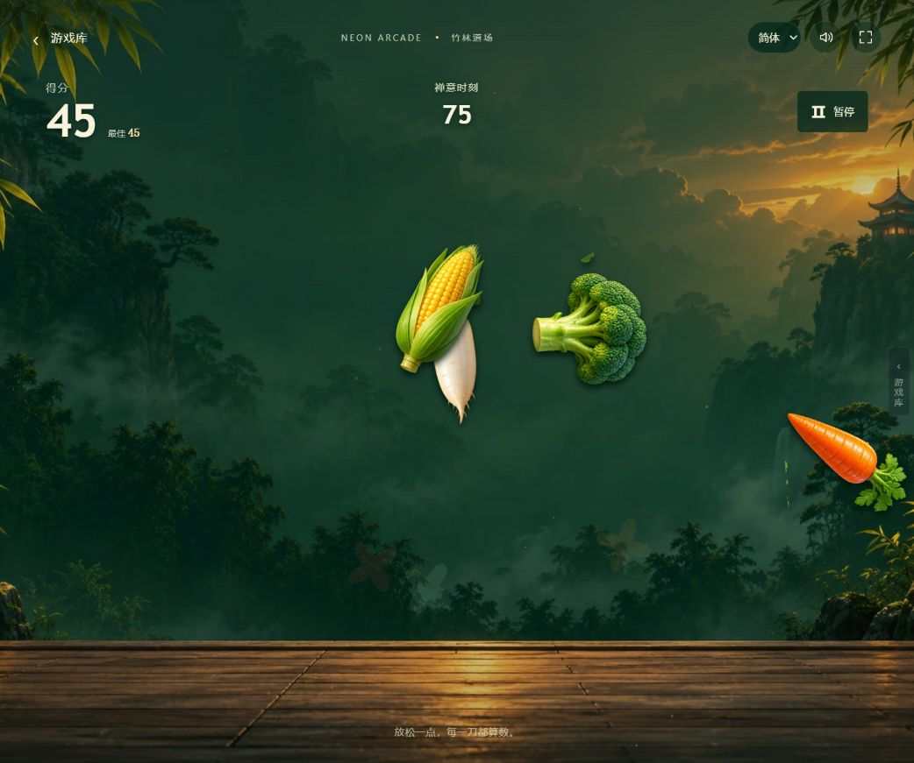

# 2026-10-19 线上源码同步

本次将 [线上站点](https://game.yituohub.com/) 的完整公开源码和运行资源同步到用户指定的公开仓库 `yan9651688/yituohub-game-arcade`。同步起点为 `2ed114a`，线上发布版本为 `20261019-republic-frontier-ui-fix-v2`；交付前再次核对，线上仍使用此版本。

## 同步范围

| 项目 | 结果 |
| --- | --- |
| 主游戏 | 11 款；补入蔬菜忍者、植物大战僵尸、吞城漫游、学园都市 |
| 经典游戏 | 18 款；包含源码、封面、游戏翻译和统一加载入口 |
| 原有游戏 | 同步魂斗罗及其他主游戏的线上更新；共和国之辉保留已上线的两处 UI 修复 |
| 站点公共部分 | 首页、游戏库、加载页、三语文案、移动端控制、SEO 与公开统计脚本 |
| AI 放映厅 | 千禧凝思更新、阿房宫场景及配套音画素材 |
| 源码与资源 | 739 个文件，共 103,528,195 字节；新增 536、更新 24、原本一致 179 |

各文件的相对路径、大小及 SHA-256 保存在 [源码清单](live-source-manifest-20261019.json)。未删除仓库原有的历史设计、文档和源码。服务器生成的 `.gz`、`.br`、部署版本记录和站点所有权验证文件不作为游戏源码导入；压缩文件由仓库构建脚本重建。

`public/` 保留线上文件的实际字节，包括已有的不同换行格式；`.gitattributes` 禁止 Git 对这一目录做自动换行转换。植物大战僵尸的第三方声明、库许可与素材来源记录随源码一起保留。

## 构建与自动验证

| 检查 | 结果 |
| --- | --- |
| 线上清单与 `public/` SHA-256 | 739 / 739 一致 |
| 线上清单与 Git 暂存内容 SHA-256 | 739 / 739 一致 |
| 线上清单与 `dist/` SHA-256 | 739 / 739 一致 |
| 两区清单 | 11 + 18 = 29；ID、入口和封面路径校验通过 |
| HTML、CSS、静态模块导入中的本地引用 | 385 处存在，未发现越界路径 |
| 独立 JS 和 HTML 内嵌 JS 语法 | 171 项通过 |
| 游戏回归 | 74 项通过：共和国之辉 52 项、魂斗罗检查点与存档 22 项 |
| 魂斗罗基础引擎 | 30 条命、复活、过关继承、八关出生点、移动射击、基地推进和双人共享生命检查通过 |
| 发布构建单元测试 | 5 项通过 |
| 压缩回读 | 165 个 gzip、165 个 Brotli 解压后均与原文件一致 |
| 完整发布构建 | 成功；含压缩文件共 1,071 个文件 |

执行命令：

```bash
python scripts/tests/test_build_release.py
node --test scripts/tests/contra-2026/*.test.mjs scripts/tests/republic-frontier/*.test.mjs
node scripts/tests/contra_engine.mjs
python scripts/build_release.py --version live-sync-20261019
```

构建脚本现支持带引号的 JSON 清单字段，校验经典区，并在发布版本记录中写入 `games`、`classics` 和 `totalGames`。魂斗罗存档集成测试使用真实控制器代码及模拟 DOM、音频、WebGL 边界，验证存档和事件顺序，不代表浏览器渲染测试。

## 浏览器抽查

使用应用内浏览器和本地静态服务器验证导入后的站点。旧预览地址曾命中旧版公共脚本缓存；更换干净的本地预览来源后，经典区正确显示 18 款游戏，无需修改线上源码。

| 页面或游戏 | 实际验证范围 |
| --- | --- |
| 主游戏库 | 本地及正式 HTTPS 页面均显示 11 款主游戏及其入口 |
| 经典游戏区 | 显示 18 款经典游戏及其入口 |
| 蔬菜忍者 | 禅意模式开始，鼠标划动获得 45 分，暂停后恢复 |
| 2048 | 进入第一关，点击向左，步数从 0/6 变为 1/6，并合并出 8 |
| 植物大战僵尸 | 主菜单、经典模式开始冒险及第一关植物选择页 |
| 吞城漫游 | 第一关进入运行状态，显示任务、倒计时，并能暂停 |
| 学园都市 | 通过统一加载页进入角色创建菜单，姓名、能力、等级、语言和开始入口均呈现 |

这是入口与代表性玩法抽查，没有逐一通关 29 款游戏。共和国之辉此前的线上操作、存档恢复及 UI 验证范围见 [原验收记录](republic-frontier/verification.md)。




## 后续协作规则

[agent.md](../agent.md) 已明确要求：完成代码修改并通过相应验证后，必须创建本项目的 Git 提交；用户要求同步 GitHub 时，必须推送指定远端与分支并核对远端提交。[AGENTS.md](../AGENTS.md) 作为代理入口读取该规则。
