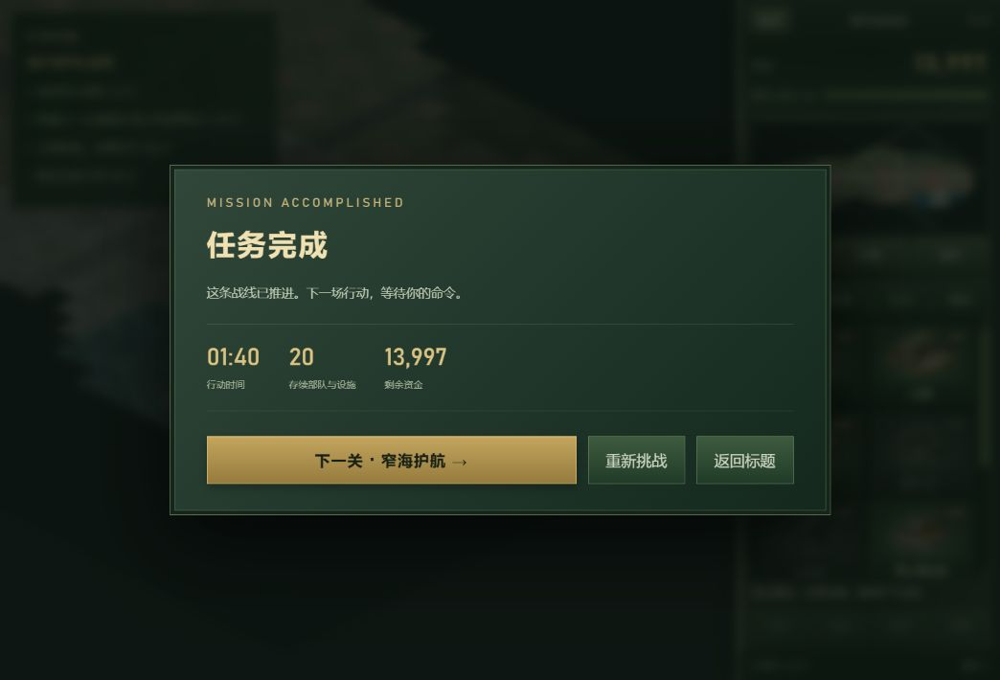
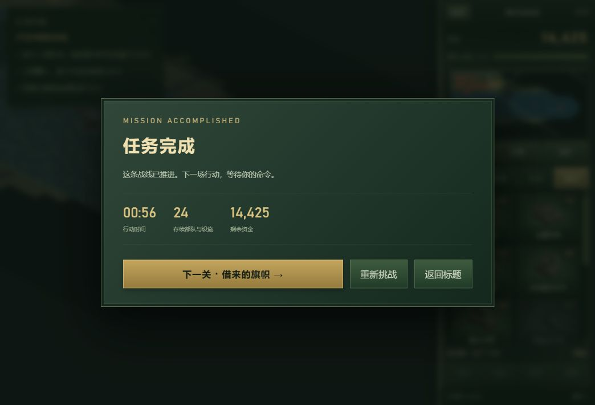

# 2026-10-19 验证记录

本次收录完整共和国之辉运行文件，同时包含已上线的侧栏布局修复和首页地图数量修正。[运行文件 SHA-256](runtime-hashes.json) 可用于核对源码与发布版本。

## 自动化验证

```sh
node --test scripts/tests/republic-frontier/*.test.mjs
```

52 项通过，0 失败。测试覆盖建筑与单位、战役阶段、存档恢复、基地部署、普通难度的命令驱动遭遇战，以及桥梁、坡道、冰雪、障碍物和建造限制。fixture 与正常命令驱动流程在测试文件中分别标明。

## 浏览器实际操作

| 场景 | 结果 |
| --- | --- |
| 本地，盟军 A1，标准难度 | 01:40 通关，经历救援、工程师占领、反扑和撤离 |
| 本地，盟军 A2，标准难度 | 00:56 通关，四艘运输船全部抵港 |
| 本地，中国冰封峡湾，标准难度 | 04:21 战败，随后成功恢复 03:28 自动存档 |
| 正式站点，中国双桥河谷，标准难度 | 展开、建造、框选、编队、移动、保存、刷新恢复通过 |
| 正式游戏库入口 | 恢复同一对局，资金、供电、施工进度一致；键鼠输入与侧栏布局正常 |

线上保存后恢复至 00:21，资金 9,353，供电 150/0，精炼厂施工 2%。发电厂已经完成，读档后的施工与游戏时钟继续推进。正式域名的 HTML、CSS 以 identity、gzip、Brotli 请求均命中正确内容，连同入口、目录和核心脚本共 10 项 HTTPS 检查通过。




## 范围

实际浏览器通关为两关，未逐一重玩全部 16 关和八张遭遇战地图，也未完成全部特殊兵种和听音验收。自动化通关不能计作浏览器实玩。浏览器工具曾出现超时，恢复后完成上述检查；这些工具调用耗时不作为游戏性能数据。

尚有两处不阻塞游玩的提示待整理：读档后可能短暂显示“尚未保存”；A3 潜入任务仍显示通用的基地车展开提示。

机器可读摘要见 [verification.json](verification.json)。

## 公开仓库接入复核

本次按公开仓库的 `public/` 目录接入，保留原有六款游戏，游戏库显示七款游戏及新增的“即时战略”分类。浏览器已确认新入口可经过仓库原有的统一加载页进入游戏主菜单，菜单显示八张遭遇战地图。

在公开仓库中重新执行了 52 项游戏回归、2 项站点构建回归，均通过。完整发布包生成成功，包含 7 款游戏及 gzip/Brotli 副本；源文件、Git 暂存内容和构建产物中的 152 个游戏运行文件均与上线版本哈希一致。
